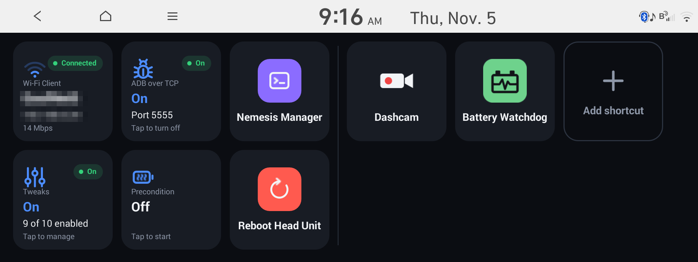

# Tilepad

A kitchen-sink launcher for Hyundai's gen5W head unit (Android 4.4), installed through
[NEMESIS](https://github.com/xwtk/hmg_nemesis): a grid of app shortcuts and status tiles, with Wi-Fi
and ADB controls, manual battery preconditioning (based on
[Launchpad](https://github.com/paytondevs/gen5w-preconditioning)'s backend) and a bundled set of
system tweaks. It's developed and tested on an IONIQ 5 (NEEV23 US).



Hold the steering wheel's **★** (custom) button for about a second to open it. Hold again to close it.
A short ★ press still runs whatever Hyundai's Button settings assign to it.

## Features

- **Wi-Fi status** (if the head unit has a Wi-Fi module): network, IP, signal. Tap to pick a network.
  On a unit whose Wi-Fi only runs the CarPlay/Android Auto hotspot, tap to turn on the Wi-Fi client.
- **Manual battery preconditioning** (if available on the vehicle): one-tap start and stop.
- **Bundled Tweaks app**: automatic DST, startup-brief bypass, configurable cold-boot
  heaters, track-button swap, independent right-handle/pop-over suppression, and
  climate tweaks: Maintain Climate Sync (passenger and driver temperatures move together) and
  Automatic Driver Only (Driver Only at start, Sync once the passenger buckles up).
  Auto-Open Phone Projection opens AA/CarPlay when available; Charge-Away switches
  Scheduled Charging off away from Home and back on at Home, preserving off-peak settings.
  Disable OTA Client stops the head unit's OTA checks and downloads.
  A permanent Tweaks and Settings tile sits beside Precondition. All eleven tweaks start off.
- **ADB toggle**: turn ADB over Wi-Fi on and off. While it's on, any computer on the network can connect without approving a key. Turning it on also turns on Wi-Fi (so wireless CarPlay/Android Auto are off).
- **Nemesis Manager** shortcut.
- **Reboot Head Unit**, with confirmation.
- **Shortcuts** to any screen, including Hyundai and system screens that have no icon.
- **Rearrange, rename and remove** tiles with a long press.

"If available" comes from the car itself: on a gas car or a unit without Wi-Fi, those tiles just
don't appear. Preconditioning works on the US and Korean IONIQ 5 and EV6 and the US IONIQ 6, on
the firmware versions it has been checked against; on other firmware the tile won't send commands.

## Tiles

| Tile | Shows | Tap |
| --- | --- | --- |
| **Wi-Fi** *(Wi-Fi module only)* | signal bars, Connected / No network / Off, network name, IP, link speed. *Hotspot only* when the client is off | Android's Wi-Fi network picker, or *turn on Wi-Fi* (see below). Long-press: the Wi-Fi MAC address, for a static IP reservation |
| **Precondition** *(EVs only)* | Off / Waiting / Active / Unavailable…, spinner while waiting, elapsed time, a *Conditioning* pill while the car's own indicator is on | see below |
| **Tweaks and Settings** | On/Off pill (on when any tweak is enabled); how many are enabled and how many are off | opens the bundled `Tweaks.apk`; each feature has a checkbox and detailed explanation |
| **ADB** | On/Off pill; the port while on, *Port closed* while off | asks to confirm, then turns ADB over Wi-Fi on or off (see below) |
| **Nemesis Manager** | | NEMESIS Manager (dimmed if it's not installed) |
| **Reboot Head Unit** | | asks to confirm, then hard-reboots the head unit (`nemesis root -c reboot`) |
| **Add shortcut** | | searchable list of every screen (apps, plus Hyundai/system screens with no icon) |

**Preconditioning, one button:**
- Off → tap: sends Start and pops up a progress popup. It shows *Waiting for BMS* (usually 60–120 s) and turns into a ✓ *Preconditioning active* when the car reports it. If the popup was closed by then, it pops up on its own.
- Waiting → tap: reopens the popup, which has **Cancel request**. A stray tap won't cancel.
- Active → tap: turns it off. The popup shows *Turning off*, then *Off*.
- Anything else (Unavailable, Error, not READY…) → tap: a popup with the car's reason.

"Active" only ever comes from the car's own indicator, never from a timer. The request keeps
going after you close Tilepad.

**Turning on the Wi-Fi client.** Stock US firmware, and wireless CarPlay/Android Auto mods
installed without their Wi-Fi client option (such as HMG Leafia Plus without `LEAFIA-WIFI-CLIENT`),
use the radio only for the projection hotspot. The tile then reads *Hotspot only*, and tapping it
offers to turn the client on. The popup then offers a reboot; until then, the tile reads *Reboot to
finish*.

- There's one Wi-Fi radio. While it's on a network, wireless CarPlay/Android Auto may not connect.
- It works alongside HMG Leafia Plus's own client option, which makes the same change.
- Uninstalling Tilepad turns the client back off (after the reboot) if Tilepad turned it on.

**ADB over Wi-Fi.** The ADB tile turns ADB over Wi-Fi on and off. Tapping it when it's off asks
to confirm, because of what "on" means:

> ⚠️ While ADB is on, **any computer that can reach the head unit can connect and get a
> root-capable shell**, with no key to approve: this head unit's adbd doesn't check keys over
> Wi-Fi. That includes the telematics modem's cellular connection, not just your Wi-Fi. Only turn
> it on while you need it, and turn it off when you're done.

> ⚠️ **Wireless CarPlay and Android Auto don't work while Wi-Fi is on.** The head unit has one
> Wi-Fi radio: it either joins a network or runs the hotspot your phone uses for wireless
> CarPlay, not both. While ADB is on, Tilepad turns the hotspot off and Wi-Fi on, at every boot
> too.

- **On** makes the head unit listen for ADB on port 5555, now and after every reboot, until you
  turn it off. Connect with `adb connect <head-unit-ip>:5555`.
- **Wi-Fi.** ADB needs the head unit on the same network as your computer, so while ADB is on,
  Tilepad turns on Wi-Fi (joining your saved network), right away and again at every boot. On a
  unit whose Wi-Fi only runs the CarPlay hotspot, turn on Wi-Fi from the Wi-Fi tile first.
- **Off** stops ADB from listening. It leaves Wi-Fi as it is.
- The head unit serves **one computer at a time**: while one is connected, another's
  `adb connect` hangs and shows `offline` or `unauthorized` until the first disconnects
  (`adb disconnect`).
- It needs NEMESIS (for root); without it the tile says so and does nothing.
- An **update** keeps ADB in whatever state you left it. **Uninstalling** Tilepad turns it off if
  the tile turned it on.

**Arranging:**
- Page one starts with a fixed block of six core tiles: Wi-Fi, ADB and Nemesis Manager on top, Tweaks, Precondition and Reboot Head Unit below. A thin vertical divider separates it from your tiles; unsupported vehicle features are still omitted.
- Your tiles fill the rest of page one (six on the car). More continue on further pages, with dots at the bottom: swipe left and right. Later pages have no fixed block or divider.
- Long-press any tile, then drag it. Tiles wiggle while you're in edit mode.
- In edit mode, shortcuts get ✎ (rename) on the top-left and − (remove) on the top-right. The six fixed tiles don't move; Add shortcut can be moved but not removed or renamed. Drag a tile to a screen edge to carry it to the next page.
- Leave edit mode with **Done**, by tapping empty space, or with Back.
- New shortcuts are added just before the Add tile. Renaming to an empty name restores the original name.

Search and rename use a built-in keyboard, so no Android IME is needed. Long-press ⌫ to clear.
The TUNE knob also works: turn it to move the highlight and press it to open the tile.

## Install (USB, no computer needed in the car)

1. **Uninstall Launchpad first** with its `Launchpad-uninstall-usb.zip`, then reboot. Tilepad
   replaces it (same preconditioning backend and hold-to-open service). Tilepad refuses to
   install (from USB or NEMESIS Manager) while any trace of Launchpad is left, and its log
   says what it found. Nothing is changed when it refuses.
   Tilepad also can't be installed alongside [HMG-API](https://github.com/VysseCodes/HMG-API):
   both change the same system apps and settings (HMG-API's ADB mod, for one, holds ADB over
   Wi-Fi off). Uninstall HMG-API first; NEMESIS refuses either one while the other is installed.
2. Download **`Tilepad-install-usb.zip`** from the [latest release](https://github.com/KramerTech/gen5-Tilepad/releases/latest)
   and extract it so its *contents* sit at the root of a FAT32/exFAT drive, with nothing else
   from NEMESIS on it:
   ```text
   USB/
   ├── NEMESIS.data
   ├── packages/tilepad.zip      (don't unzip this)
   └── tilepad/{common,lib,install}.sh
   ```
3. In the car (parked, head unit fully booted), plug the drive into a USB data port and tap
   **Yes** on the NEMESIS prompt. Wait for the result dialog.
4. Reboot the head unit (pinhole button), remove the drive, and hold ★ on the steering wheel.

The installer writes `tilepad-install.log` to the drive. **Update** works the same way with
`Tilepad-update-usb.zip` and keeps your tiles and tweak settings. From 1.2.0 on, Tilepad can also
update itself: connect the head unit to Wi-Fi (a phone hotspot works), open **Tweaks and Settings** → **Package Manager**
and tap **Check for Updates**. It lists Tilepad and each linked package with its version. It only uses Wi-Fi, never the car's built-in modem, installs only a release
signed with Tilepad's key, and restarts the head unit when it's done, so do it while parked. Under
**Configure Other Software** you can link other NEMESIS packages you've installed to the
GitHub repositories they come from, and the same check updates them too, straight from their
developers' releases, even packages that aren't in the NEMESIS Package Store. A package in that
repository that isn't installed yet can be installed from there too. Package Manager only manages
Tilepad and the packages linked there: a package you installed from NEMESIS Manager and didn't link
keeps updating through NEMESIS Manager. The bin beside a linked package uninstalls it, or only unlinks
it. **Uninstall** uses
`Tilepad-uninstall-usb.zip`: it undoes any tweaks first, then removes Tilepad and its saved
settings (including the Charge-Away Home location).

| Release file | Use |
| --- | --- |
| `Tilepad-install-usb.zip` | first install |
| `Tilepad-update-usb.zip` | update an existing install, keeping your tiles |
| `Tilepad-uninstall-usb.zip` | remove Tilepad |
| `tilepad.zip` | the NEMESIS package itself, for `nemesis install` over ADB (don't extract it onto a drive) |
| `tilepad.zip.sig` | its signature, which Check for Updates verifies before installing |
| `Tilepad.apk`, `Tweaks.apk` | the signed apps, for reference |
| `SHA256SUMS` | checksums of the files above |

## Supported cars

Tilepad can work on any gen5W head unit. If something shows an error or a tweak is unavailable on
yours, submit a compatibility report (below) so support can be added.

The tweaks check the car's exact firmware files, so they work on any car on a supported firmware
image: USA Hyundai `V012.010.240822`, `V015.012.260507` and `V016.010.260903`, and USA Kia `V015.012.260507` (for
example, the IONIQ 5 and EV6). Heaters a trim lacks are skipped. How each tweak works,
and what it changes, is in [docs/TWEAKS.md](docs/TWEAKS.md).

**Submitting a compatibility report:** open **Tweaks and Settings**, select an unavailable tweak, plug in
a USB drive and tap **Capture Compatibility Log to USB**. Then attach the
`tilepad-compat-….zip` from the drive to a
[compatibility issue](https://github.com/KramerTech/gen5-Tilepad/issues/new?template=compatibility.md).
It holds the head unit's software version, file hashes, the firmware code the tweaks rely on, and
numeric vehicle-equipment readings; no location, Home or personal names.

**Reporting a problem:** if a tweak doesn't take effect, or something happens that shouldn't, then
while it's still showing or as soon as you notice (before turning the car off), plug in a USB drive,
open **Tweaks and Settings** → **Support** and tap **Save Log to USB**. Attach the `tilepad-log-….zip` from the drive
to a [problem report](https://github.com/KramerTech/gen5-Tilepad/issues/new?template=problem.md) and
say what you expected and what you saw instead. Besides what the compatibility report holds, it covers the last few minutes: what was
on screen, which apps opened, the right-hand panel's and startup screen's messages, Tilepad's
service log, and whether each patched file is as set. Media, call, contact, radio and driver-profile
messages are left out.

## Troubleshooting

- Holding ★ does nothing: check NEMESIS Manager → Services → `tilepad/longstar`.
- Anything else: NEMESIS Manager → Logs → Copy to USB, or `adb logcat | grep -i tilepad` with ADB
  on, and attach it to an [issue](https://github.com/KramerTech/gen5-Tilepad/issues).

## More

How Tilepad works, building and releasing: [docs/TECHNICAL.md](docs/TECHNICAL.md).

Credits: [NEMESIS](https://github.com/xwtk/hmg_nemesis), Launchpad by paytondev,
[Ioniq5_CAN](https://github.com/tylerharvey/Ioniq5_CAN),
[gen5w-utils](https://github.com/Helloyunho/gen5w-utils).
